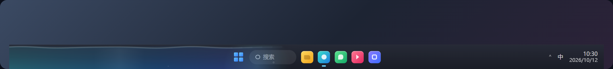
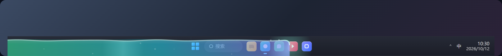
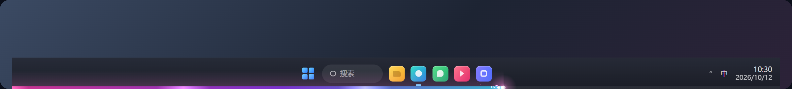
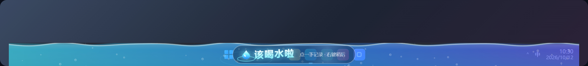
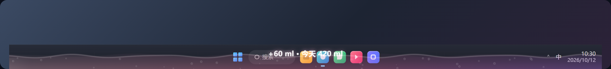
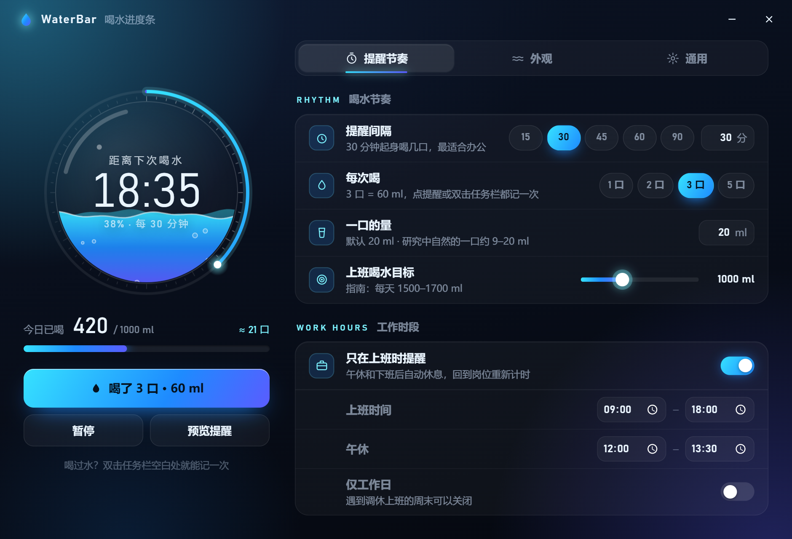
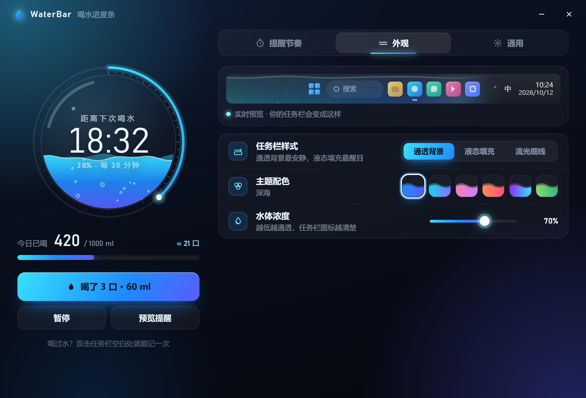
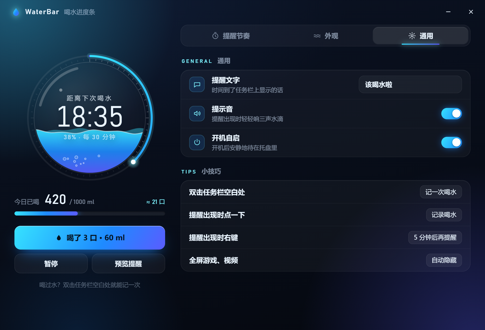

# 💧 WaterBar · 喝水进度条

把 Windows 任务栏变成一根会流动的「喝水进度条」。
时间一点点过去，水慢慢漫过任务栏；时间到了，任务栏上弹出「该喝水啦」，点一下就记下这次喝水。



## 截图

### 三种任务栏样式

**通透背景**（默认）：很淡的一层水色，从底部向上淡出，前沿柔和渐隐，任务栏图标保持清晰。


**液态填充**：更醒目的液体，带波浪、气泡、水面高光和发光前沿。



**流光细线**：贴在任务栏底部的一条发光细线，带彗星光点。



### 提醒与记录

时间到了：水涨满整条任务栏，弹出会跳动的「该喝水啦」。



点一下（或双击任务栏空白处）记录喝水：水被「喝掉」，浮出本次和今天的毫升数。



### 设置窗口

左边是今天的概览（倒计时水球、今日已喝 ml、快捷按钮），右边分为三个标签页。

| 提醒节奏 | 外观 |
| --- | --- |
|  |  |



## 功能

- **三种样式 · 六套主题**：通透背景 / 液态填充 / 流光细线；深海、极光、樱花、落日、霓虹、抹茶，可调水体浓度，设置里有实时预览。
- **按 ml 记录，不按杯**：没人会一次喝完一大杯，通常是喝几口。一口默认 **20 ml**（可改），每次记 1 / 2 / 3 / 5 口，显示「今日已喝 / 目标」。
- **三种记录方式**：提醒时**左键**记录；**右键** 5 分钟后再提醒；任何时候**双击任务栏空白处**都记一次（双击应用图标、托盘、时钟不会触发）。
- **工作时段**：默认 09:00–18:00，12:00–13:30 午休自动暂停，下班后不打扰，回到岗位重新计时；可选「仅工作日」。
- **不打扰**：全屏游戏 / 视频时自动隐藏；任务栏设为自动隐藏时，变成屏幕边缘的一条细线。
- **托盘常驻**：打开设置、记一次、只重新计时、暂停、预览提醒、退出；可开机自启；重复启动只会打开已运行的设置窗口。
- **提示音**：提醒时三声合成的水滴声（可关闭）。

## 默认值怎么来的

| 依据 | 数值 |
| --- | --- |
| 自然的一口水 | 约 **20 ml**（研究中自然饮水一口约 9–20 ml，自选一口平均 19.8 ml） |
| 每天饮水（《中国居民膳食指南（2022）》） | 男性 1700 ml、女性 1500 ml，主动喝水、少量多次 |
| 上班时段目标 | 约 **1000 ml**（其余在早晚喝） |
| 默认节奏 | 每 **30 分钟**提醒一次（也正好起身活动），每次 **3 口 ≈ 60 ml**，一个工作日约 15 次 ≈ 900–1000 ml |

参考：
[Thin Liquid Sip Sizes in Outpatient Adults (PMC)](https://pmc.ncbi.nlm.nih.gov/articles/PMC13379208/) ·
[Lawless et al. 2003, sip volume](https://pubmed.ncbi.nlm.nih.gov/14506985/) ·
[《中国居民膳食指南（2022）》准则六：足量饮水](https://wjw.hubei.gov.cn/bmdt/jkhb/spyy/202205/t20220520_4135831.shtml)

## 使用

1. 运行 `WaterBar.exe`（单文件，无需安装；需要 WebView2，Windows 10/11 已自带）。
2. 第一次启动会打开设置窗口；关掉后程序留在托盘 💧。左键托盘图标重新打开设置，右键打开菜单。
3. 设置会自动保存在 `%APPDATA%\com.waterbar.app\settings.json`。

| 操作 | 效果 |
| --- | --- |
| 提醒出现时左键点任务栏 | 记一次喝水并重新计时 |
| 提醒出现时右键 | 5 分钟后再提醒 |
| 双击任务栏空白处 | 记一次喝水并重新计时 |
| 托盘「只重新计时」 | 重新计时，不记录喝水 |
| `WaterBar.exe --preview` | 立刻预览一次提醒 |

## 从源码构建

需要：Windows 10/11 x64、[Rust](https://rustup.rs/)（stable，加上 `x86_64-pc-windows-msvc` 目标）、Visual Studio C++ 生成工具、Node.js 18+。

```powershell
rustup target add x86_64-pc-windows-msvc
npm install
npm run build
```

生成的程序在 `src-tauri/target/x86_64-pc-windows-msvc/release/WaterBar.exe`（`src-tauri/.cargo/config.toml` 已指定 MSVC 目标）。

## 技术说明

- **Tauri 2**（Rust + WebView2），界面是原生 HTML / CSS / Canvas，没有前端框架。
- **叠加窗口**：一个透明、置顶、点击穿透的窗口精确盖在任务栏上（`WS_EX_LAYERED | WS_EX_TRANSPARENT`），提醒时才变为可点击；用 Win32 跟踪任务栏位置、层级和全屏状态。
- **渲染**：WebView2 使用软件渲染（`--disable-gpu`），波浪形状、光晕和文字都预先画成小贴图，每帧只做贴图和矩形填充；平时约 30 fps，动画时 60 fps。原因是在混合显卡 + 240 Hz 屏幕上，浏览器的 GPU 路径每帧代价很高。
- **双击记录**：低级鼠标钩子只「观察」点击，不拦截；再通过 UI Automation 读取任务栏按钮的位置，排除图标、托盘和时钟。
- 代码结构：`src-tauri/src/main.rs`（状态、计时、托盘、命令）、`src-tauri/src/win.rs`（Win32 / UI Automation）、`ui/liquid.js`（任务栏渲染）、`ui/overlay.js`（叠加窗口）、`ui/settings.*`（设置窗口）。

## 已知限制

- 只在主显示器的任务栏上显示。
- 进度条画在任务栏**上面**一层，不是在背景和图标之间：Windows 没有官方方法把内容插到任务栏背景与图标之间。所以通透背景故意做得很淡，让图标保持清晰。
